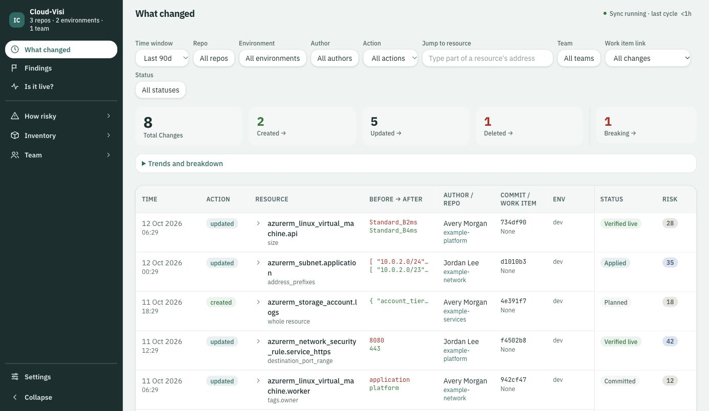
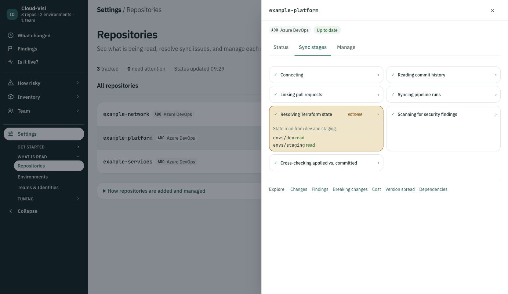
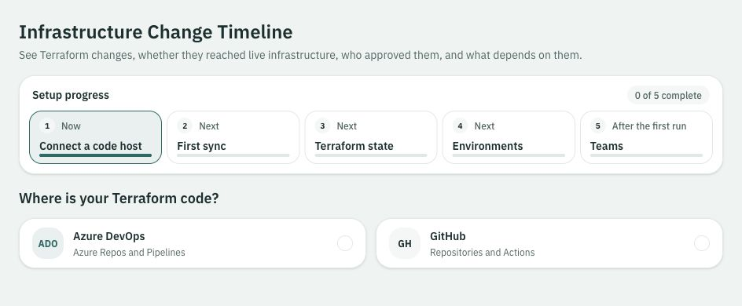

# Cloud-Visi

**Terraform change intelligence for DevOps, platform, and SRE teams.**

Infrastructure context is often spread across commits, pull requests, pipeline runs, and Terraform state. Cloud-Visi brings the information it can read into one place, so you can explore a resource's history and the evidence behind its changes.

Run it in your own environment and connect the Terraform repositories you already work with. Connections to your code host and state storage are read-only. You can start with code history and add state access later.

- **Code changes:** before-and-after values, commits, and pull request context.
- **Delivery evidence:** pipeline activity and supported Terraform plan or apply results.
- **State context:** resources and values from the Terraform state last read.

A successful pipeline run alone does not prove that a change was applied. Cloud-Visi keeps the available evidence and its limits visible. See [what information can be read](docs/available-information.md).

This repository contains deployment files and partner guides. Product source is maintained separately.

**Release status:** the beta image is `ghcr.io/cloud-visi/cloud-visi:0.1.0-beta.1`, with Linux AMD64 and ARM64 support. See the [beta release](https://github.com/cloud-visi/cloud-visi-deploy/releases/tag/v0.1.0-beta.1). The OCI chart remains unpublished; install the chart files from this repository. The licence is still undecided. GitHub created the package as private; public GHCR access is awaiting the owner's visibility change. The release asset contains the compiled OCI image archive.

## Choose how to run it

| Your environment | Start here |
| --- | --- |
| A Kubernetes cluster | [Install with Helm](docs/kubernetes.md) |
| Docker Desktop with Kubernetes enabled | [Docker Desktop Kubernetes](docs/docker-desktop.md) |
| Docker Desktop without Kubernetes | [Optional Docker Compose setup](docs/compose.md) |

Kubernetes with Helm is the supported deployment path for this preview. Compose is an optional local setup.

## A look inside

These are screenshots of the current application UI. The change history and repository views use fictional example data. A fresh installation starts empty; what appears depends on your connected repositories and the evidence available to read.

### Terraform changes

Changes show the resource, before-and-after values, repository context, and available status.

### Repository sync details

Compact repository rows open a detail panel with sync stages and optional state information.

### First connection

The setup screen lets you choose Azure DevOps or GitHub. Terraform state access can be added later.

## Before you connect a repository

Choose a GitHub or Azure DevOps repository that contains Terraform `.tf` files. Start with a repository you know and have permission to read. There is no need to create infrastructure, change a pipeline, or run Terraform to try the application.

A repository can contain several Terraform folders. Shared module repositories can provide code history, but modules by themselves do not provide the Terraform state of the projects that use them.

You will need a read-only token for your chosen code host. Terraform state access is optional. See [repository and credential setup](docs/connect-repositories.md).

## After installation

Open Cloud-Visi, choose your code host, and follow the setup form. Choose which repositories to connect. Cloud-Visi reads their existing history in the background, so the first sync can take some time.

Use it for your own work. There is no required evaluation task or prescribed outcome. If you want to share feedback, see [giving feedback](docs/feedback.md).

## More information

- [What information can be read](docs/available-information.md)
- [Configuration reference](docs/configuration.md)
- [Restart, upgrade, backup, and remove](docs/operations.md)
- [Troubleshooting](docs/troubleshooting.md)

## Access and data

The preview has no built-in login. Its Kubernetes service is reachable inside the cluster, so use a trusted namespace and network boundary. Keep access private. The default Helm instructions use port forwarding, and Compose binds only to localhost. Shared access requires your existing authentication gateway.

Repository copies, history, and saved credentials are stored in your installation. Code host and cloud connections use the credentials you provide. This deployment does not configure a hosted analytics service.

Public issues are visible to everyone. Do not attach tokens, Terraform state, private code, database backups, or unredacted logs.
