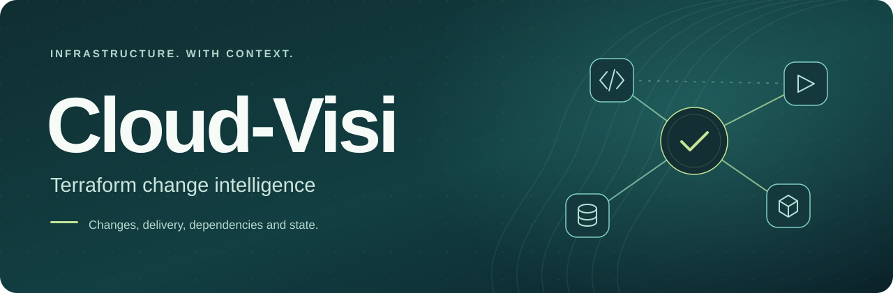
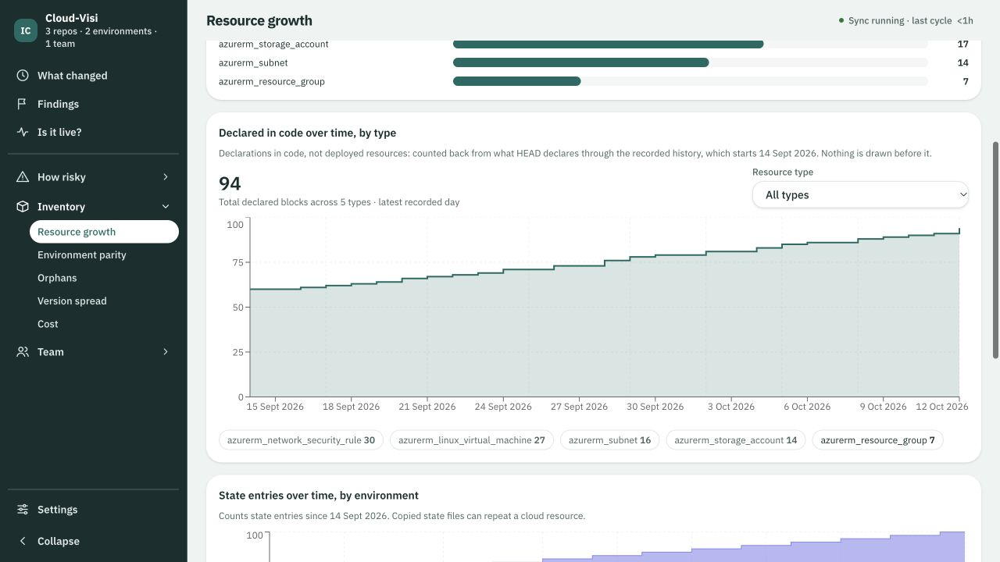
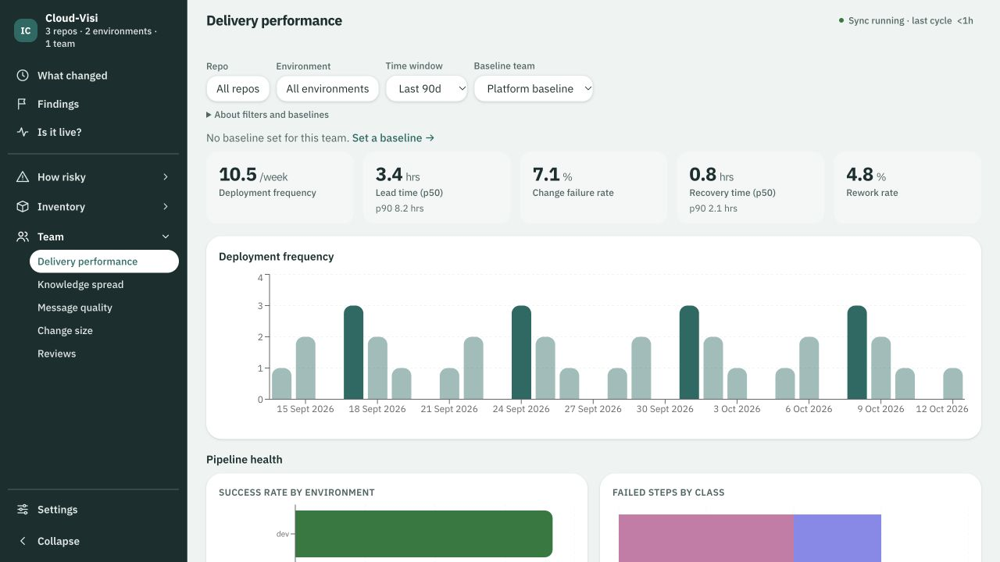
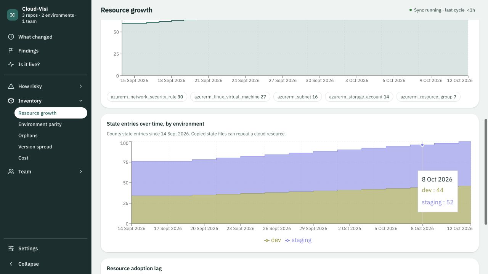
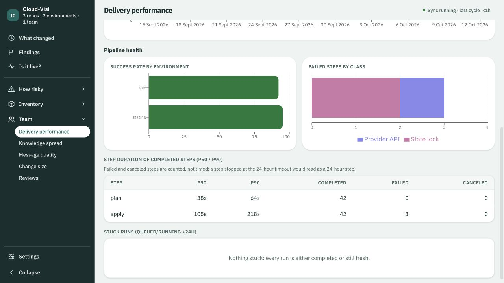

# Cloud-Visi | Terraform change intelligence

**Understand what changed in Terraform, how it moved through CI/CD, and which resources it touches.**

Cloud-Visi brings Terraform code history, pull requests, pipeline runs, resource dependencies, and optional Terraform state into one place. DevOps engineers, platform engineers, and SREs can follow an infrastructure change from its commit to the plan, apply, and state evidence available for it.

Run Cloud-Visi in your own environment. Connect Terraform repositories in **GitHub or Azure DevOps**, read pipeline activity from **GitHub Actions or Azure Pipelines**, and optionally connect state in **Azure Blob Storage or AWS S3**. Code host and state connections are read-only.

## Explore your Terraform infrastructure

| Capability | What you can explore |
| --- | --- |
| **Terraform change tracking** | Resource additions, updates, and removals with before-and-after values, commits, and pull requests. |
| **Plan and apply visibility** | Supported Terraform plan and apply results alongside pipeline runs, failed applies, and available state confirmation. |
| **Resource change history** | A resource's code changes, recorded state, and delivery evidence in one timeline. |
| **Infrastructure dependency mapping** | Resource relationships and resolved cross-state references to explore what a change could affect. |
| **Terraform state and environment comparison** | Resources from the state last read and differences between configured environments. |
| **Resource growth and delivery analytics** | Charts for infrastructure growth, resource types, deployment frequency, lead time, and pipeline health. |
| **Team and review context** | Contributor activity, knowledge spread, and the pull request reviews available from your code host. |
| **Change investigation** | Resource findings, incident timelines, and context to review before changing a resource. |

The available detail depends on your repositories, permissions, workflow formats, and readable state. GitHub Actions support currently has less coverage than Azure Pipelines. A successful pipeline run alone does not prove a change was applied, and Terraform state is not a live cloud inventory. See [supported information and evidence limits](docs/available-information.md).

This public repository contains deployment files and partner guides. Product source is maintained privately.

**Beta available:** `ghcr.io/cloud-visi/cloud-visi:0.1.0-beta.1` supports Linux AMD64 and ARM64, with verified downloads without a registry login. The Helm chart files are included here and ready to install. See the [beta release](https://github.com/cloud-visi/cloud-visi-deploy/releases/tag/v0.1.0-beta.1). The licence remains undecided.

## Choose how to run it

| Your environment | Start here |
| --- | --- |
| A Kubernetes cluster | [Install with Helm](docs/kubernetes.md) |
| Docker Desktop with Kubernetes enabled | [Docker Desktop Kubernetes](docs/docker-desktop.md) |
| Docker Desktop without Kubernetes | [Optional Docker Compose setup](docs/compose.md) |

Kubernetes with Helm is the supported deployment path for this preview. Compose is an optional local setup.

## A look inside

Real application screens with fictional example data. Charts and history in your installation depend on your connected repositories and readable evidence. A fresh installation starts empty.

### Infrastructure growth and Terraform resource trends

Explore declared resources over time by type. Separate state charts show the entries read from each environment's Terraform state.

### Delivery performance and pipeline health

Explore deployment frequency, lead time, change failure rate, recovery time, and rework from readable pipeline evidence. Pipeline health adds success rates by environment, failure categories, and step durations.

More charts: state trends and pipeline health

### Terraform state trends by environment

Compare the entries recorded in Terraform state for each environment over time.

### Pipeline health charts

View success rates by environment, failed step categories, and durations of completed plan and apply steps.

### Terraform changes and resource history

Follow resource changes with before-and-after values, repository context, and available delivery status.

Repository sync and first connection

### Repository sync details

Compact repository rows open a detail panel with sync stages and optional state information.

### First connection

Choose Azure DevOps or GitHub. Terraform state access can be added later.

## Before you connect a repository

Choose a GitHub or Azure DevOps repository that contains Terraform `.tf` files. Start with a repository you know and have permission to read. There is no need to create infrastructure, change a pipeline, or run Terraform to try the application.

A repository can contain several Terraform folders. Shared module repositories can provide code history, but modules by themselves do not provide the Terraform state of the projects that use them.

You will need a read-only token for your chosen code host. Terraform state access is optional. See [repository and credential setup](docs/connect-repositories.md).

## After installation

Open Cloud-Visi, choose your code host, and follow the setup form. Choose which repositories to connect. Cloud-Visi reads their existing history in the background, so the first sync can take some time.

Use it for your own work. There is no required evaluation task or prescribed outcome. If you want to share feedback, see [giving feedback](docs/feedback.md).

## More information

- [What information can be read](docs/available-information.md)
- [Configuration reference](docs/configuration.md)
- [Upcoming 30-day trial activation](docs/trial.md)
- [Restart, upgrade, backup, and remove](docs/operations.md)
- [Troubleshooting](docs/troubleshooting.md)

## Access and data

The preview has no built-in login. Its Kubernetes service is reachable inside the cluster, so use a trusted namespace and network boundary. Keep access private. The default Helm instructions use port forwarding, and Compose binds only to localhost. Shared access requires your existing authentication gateway.

Repository copies, history, and saved credentials are stored in your installation. Code host and cloud connections use the credentials you provide. This deployment does not configure a hosted analytics service.

Public issues are visible to everyone. Do not attach tokens, Terraform state, private code, database backups, or unredacted logs.
